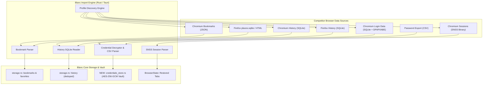

# Browser Data Import (Bookmarks, History, Passwords & Sessions) — Audit & Implementation Plan

## Goal Description

The user requested an audit of the codebase to determine if and how a browser data import feature can be implemented — specifically importing **bookmarks, passwords, browsing history, and other browser data** from competitor browsers (Google Chrome, Microsoft Edge, Brave, Mozilla Firefox, Safari, etc.) and integrating them into Blanc.

This document provides:
1. **A comprehensive audit** of Blanc's existing codebase across all targets (Electron desktop, Rust/Tauri desktop, and Android).
2. **A deep technical feasibility analysis** of each browser data category (Bookmarks, History, Passwords, Open Tabs, Search Engines), including modern OS security mitigations (such as Google Chrome's App-Bound Encryption on Windows).
3. **An architectural proposal** for implementing a complete, secure, user-controlled browser data importer in `blanc-tauri` (with parity notes for Electron).
4. **Concrete code designs, data structures, and UI workflows** for importing and storing this data.

---

## Codebase Audit: Current State of Browser Import in Blanc

### 1. Electron Desktop (`src/main/`, `src/renderer/`)
Blanc's Electron implementation already contains a sophisticated partial import system for Bookmarks and Open Tabs:
- [`src/main/browser-data-import.js`](file:///D:/blanc/src/main/browser-data-import.js):
  - Automatically discovers user profiles for Google Chrome, Microsoft Edge, Brave, Chromium, and Vivaldi across Windows (`LOCALAPPDATA`), macOS (`~/Library/Application Support`), and Linux (`~/.config`).
  - Reads and parses Chromium JSON `Bookmarks` files into Blanc Favorites/Bookmarks.
  - Limits file reads to 20 MiB and 100,000 nodes to prevent memory exhaustion and DoS.
  - Implements Chromium timestamp conversion (`CHROMIUM_EPOCH_OFFSET_MS = 11_644_473_600_000`).
- [`src/main/bookmark-import.js`](file:///D:/blanc/src/main/bookmark-import.js):
  - Parses universal Netscape Bookmark HTML format (`<DT><A HREF=...>`, `<H3>` folders) exported by Firefox, Safari, and Chrome.
- [`src/main/chromium-session.js`](file:///D:/blanc/src/main/chromium-session.js):
  - Implements binary SNSS session parsing (`Session_*` files) for "Bring your open tabs" (Feature F40).
- **What is missing in Electron:**
  - **No Password import**: Passwords are not read.
  - **No History import**: Browsing history SQLite databases are not read.
  - **No Firefox SQLite import**: Firefox `places.sqlite` is not directly read (relies on HTML export).

### 2. Tauri Desktop (`blanc-tauri/`)
The `blanc-tauri` workspace is the active development target. An audit of `blanc-tauri` reveals:
- **Zero browser import capabilities**: There is currently no profile discovery, no Chromium bookmarks parser, no HTML bookmarks parser, and no SQLite reader.
- **Storage Subsystem ([`storage.rs`](file:///D:/blanc/blanc-tauri/src-tauri/src/storage.rs))**:
  - Implements atomic `JsonStore` persistence for `Bookmark`, `Favorite`, `HistoryEntry`, and `UserSettings`.
  - Currently has individual `add_history`, `add_bookmark`, and `favorites_add` methods, but no batch ingestion or deduplication pipeline for foreign browser data.
- **Credential Subsystem ([`credentials.rs`](file:///D:/blanc/blanc-tauri/src-tauri/src/credentials.rs))**:
  - Contains only an interface for an external 1Password SDK broker (macOS-only).
  - **Blanc does NOT currently have a built-in password manager, local password vault, or autofill engine.**
- **UI Surfaces**:
  - [`BookmarksPage.tsx`](file:///D:/blanc/blanc-tauri/src/components/pages/BookmarksPage.tsx), [`HistoryPage.tsx`](file:///D:/blanc/blanc-tauri/src/components/pages/HistoryPage.tsx), and [`SettingsPage.tsx`](file:///D:/blanc/blanc-tauri/src/components/pages/SettingsPage.tsx) do not currently have an "Import Browser Data" flow.

### 3. Specifications & Invariants ([`spec/features.md`](file:///D:/blanc/spec/features.md), [`spec/divergence-register.md`](file:///D:/blanc/spec/divergence-register.md))
- **Feature F30 (Browser Favorites Migration)** & **D22 (Discovery Divergence)**:
  - *Explicit User Action*: Discovery must never run silently in the background; it starts only when the user explicitly clicks "Look for other browsers" or reaches the onboarding import step.
  - *Add-only & Idempotent*: Existing items take precedence; re-importing does not create duplicates.
  - *Privacy Rule*: *"Import accepts only supported web Favorites, preserves folders where the source carries them, deduplicates without replacing existing data, and never expands into passwords, history, cookies, or sessions without a separately specified choice."*

---

## Technical Feasibility Analysis: Can We Import Each Data Type?



### 1. Bookmarks & Favorites: **100% FEASIBLE**
- **Chromium (Chrome, Edge, Brave, Vivaldi, Opera, Arc)**:
  - Format: Plain JSON file at `<UserDataPath>/<Profile>/Bookmarks`.
  - Structure: Hierarchy of nodes (`bookmark_bar`, `other`, `synced`) with URLs, titles, folder structures, and `date_added` (microseconds since 1601-01-01).
- **Mozilla Firefox**:
  - Format: SQLite database at `<AppData>/Mozilla/Firefox/Profiles/<Profile>/places.sqlite`.
  - Table: `moz_bookmarks` joined with `moz_places`.
- **Universal Export**:
  - Format: Netscape Bookmark HTML format (`<!DOCTYPE NETSCAPE-Bookmark-file-1>`).
- **Blanc Integration**:
  - High fidelity. Can preserve folder hierarchy, tags, and timestamps directly into Blanc's `Bookmark` and `Favorite` structures in `storage.rs`.

### 2. Browsing History: **HIGHLY FEASIBLE (with file-copy locking handling)**
- **Chromium**:
  - Format: SQLite database at `<UserDataPath>/<Profile>/History`.
  - Tables: `urls` (`url`, `title`, `visit_count`, `last_visit_time`) and `visits` (`visit_time`).
  - **Critical Technical Detail**: If the source browser (e.g., Chrome or Edge) is currently running, the SQLite file is locked by the OS (`EBUSY` / `busy_timeout`).
  - **Solution**: Importers (like Firefox and Brave) copy `History`, `History-wal`, and `History-shm` into a temporary directory in memory or temp disk, then open the copy with `sqlite3` in read-only mode (`SQLITE_OPEN_READONLY`).
- **Firefox**:
  - Format: `places.sqlite` (`moz_places`, `moz_historyvisits`). Same temp-copy strategy.
- **Blanc Integration**:
  - Map into `storage::HistoryEntry { id, url, title, visited_at, visit_count }`. Convert timestamps to Unix seconds and truncate to the history cap (e.g., 2,000–10,000 entries).

### 3. Open Tabs & Sessions: **100% FEASIBLE**
- **Chromium**:
  - Format: Binary SNSS format in `<UserDataPath>/<Profile>/Sessions/Session_<timestamp>`.
  - Blanc's Electron app already implements `chromium-session.js` to parse this binary stream. This logic can be ported to pure Rust in `blanc-tauri`.
- **Blanc Integration**:
  - Allows users to migrate their entire open tab set from Chrome or Edge into Blanc in one click.

### 4. Passwords & Saved Logins: **COMPLEX & HEAVILY CONSTRAINED**

> [!CAUTION]
> **Modern OS & Browser Security Constraints on Password Extraction:**
> 1. **Google Chrome 127+ App-Bound Encryption (Windows)**:
>    Starting with Chrome 127 (July 2024), Google introduced **App-Bound Encryption (ABE)** on Windows. The encryption key in `Local State` is protected by an elevated Windows service (`elevation_service.exe`) that cryptographically binds decryption to Google-signed `chrome.exe`. External processes (even running as the same user account) receive an `Access Denied` error when attempting to decrypt Chrome's `os_crypt.encrypted_key`.
> 2. **macOS Keychain Protections**:
>    Chromium stores encryption keys in the macOS Keychain under `"Chrome Safe Storage"`. Accessing it from Blanc triggers a native OS prompt requiring the user to enter their macOS administrator/account password.
> 3. **Firefox NSS Encryption**:
>    Stored in `logins.json` and encrypted via `key4.db` (NSS database using PBKDF2 + AES/3DES). Decryption requires bundling NSS decryption libraries.

> [!IMPORTANT]
> **The Missing Architectural Requirement in Blanc:**
> Even if passwords could be extracted from another browser:
> **Blanc currently has NO built-in password store or autofill engine!**
> Blanc currently:
> - Has no `passwords.json` or credential vault.
> - Has no settings UI to view, search, edit, or copy passwords.
> - Has no form detection or autofill script injected into WebViews to fill credentials.
> - Relies exclusively on the external macOS 1Password app integration.

#### The Recommended Strategy for Passwords:
To integrate passwords properly, we propose a two-tier approach:
1. **Tier 1 (Universal & Reliable): Password CSV Import**:
   - Every browser (Chrome, Edge, Firefox, Brave, Safari) has `Settings → Passwords → Export passwords (CSV)`.
   - CSV format is standard (`name, url, username, password, note`).
   - 100% immune to App-Bound Encryption, cross-platform, transparent, and user-authorized.
2. **Tier 2 (Direct Browser Extraction where OS permits)**:
   - Microsoft Edge (on systems still using DPAPI AES-GCM without ABE).
   - Brave and older Chrome versions on Windows using standard DPAPI.
   - macOS Keychain integration (where user approves OS Keychain prompt).
   - If direct decryption fails due to Chrome ABE, Blanc displays a helpful fallback: *"Chrome protects its password vault with App-Bound Encryption. Use Chrome's Export Passwords (CSV) to import seamlessly."*
3. **Tier 3 (Blanc Local Encrypted Vault)**:
   - Create a local encrypted store (`credentials_store.rs`) using AES-256-GCM keyed via OS DPAPI (Windows) or Keychain (macOS).
   - Add a "Passwords" section in Settings to manage imported logins.
   - Add basic form autofill via WebView script injection.

---

## User Review Required

> [!IMPORTANT]
> **Key Decisions for User Feedback:**
> 1. **Password Manager Scope**: Do you want Blanc to become a full standalone password manager (with encrypted storage, Passwords UI in Settings, and form autofill), OR do you prefer Blanc to import passwords into an encrypted vault primarily for export/reference and future autofill?
> 2. **Target Platform**: While this audit covers both Electron and Tauri, is the active target **`blanc-tauri`** where you want this feature built first, or do you want it in both? (Our plan below implements it primarily for `blanc-tauri`, while preserving compatibility with Electron).
> 3. **Data Scope**: Should the default import modal let users check/uncheck categories? (Recommended: Checkboxes for `☑ Bookmarks & Favorites`, `☑ Browsing History`, `☑ Open Tabs`, `☐ Saved Passwords`).

---

## Proposed Changes

### Component 1: Tauri Backend — Core Importer Subsystem (`src-tauri`)

#### [MODIFY] `blanc-tauri/src-tauri/Cargo.toml`
Add required dependencies for SQLite querying and cryptography:
```toml
[dependencies]
# ... existing dependencies ...
rusqlite = { version = "0.31", features = ["bundled"] }
aes-gcm = "0.10"
tempfile = "3.10"
csv = "1.3"

[target.'cfg(windows)'.dependencies]
windows = { version = "0.62", features = [
    # ... existing features ...
    "Win32_Security_Cryptography", # For DPAPI CryptUnprotectData
] }
```

---

#### [NEW] `blanc-tauri/src-tauri/src/import/mod.rs`
Public module orchestrating browser discovery and migration:
```rust
pub mod discovery;
pub mod bookmarks;
pub mod history;
pub mod passwords;
pub mod sessions;
pub mod html;

use serde::{Deserialize, Serialize};

#[derive(Debug, Clone, Serialize, Deserialize)]
pub struct BrowserProfileSource {
    pub id: String,
    pub browser_id: String,
    pub browser_name: String,
    pub profile_name: String,
    pub profile_path: String,
    pub has_bookmarks: bool,
    pub has_history: bool,
    pub has_passwords: bool,
    pub has_sessions: bool,
}

#[derive(Debug, Clone, Serialize, Deserialize)]
pub struct ImportOptions {
    pub source_id: String,
    pub import_bookmarks: bool,
    pub import_history: bool,
    pub import_passwords: bool,
    pub import_open_tabs: bool,
}

#[derive(Debug, Clone, Serialize, Deserialize)]
pub struct ImportResult {
    pub bookmarks_imported: usize,
    pub bookmarks_skipped: usize,
    pub history_imported: usize,
    pub passwords_imported: usize,
    pub tabs_imported: usize,
    pub warnings: Vec<String>,
}
```

---

#### [NEW] `blanc-tauri/src-tauri/src/import/discovery.rs`
Discovers installed Chromium (Chrome, Edge, Brave, Vivaldi, Arc) and Firefox profiles on Windows, macOS, and Linux:
- Windows: Scans `%LOCALAPPDATA%\Google\Chrome\User Data`, `%LOCALAPPDATA%\Microsoft\Edge\User Data`, `%LOCALAPPDATA%\BraveSoftware\Brave-Browser\User Data`, `%APPDATA%\Mozilla\Firefox\Profiles`.
- Parses `Local State` JSON to extract profile display names.
- Validates the existence of `Bookmarks`, `History`, `Login Data`, and `Sessions`.

---

#### [NEW] `blanc-tauri/src-tauri/src/import/bookmarks.rs` & `html.rs`
- **`bookmarks.rs`**: Parses Chromium `Bookmarks` JSON tree up to 20 MiB / 100,000 nodes.
- **`html.rs`**: Implements Netscape Bookmark HTML parser for universal HTML exports.
- Converts items into `storage::Bookmark` and `storage::Favorite`.

---

#### [NEW] `blanc-tauri/src-tauri/src/import/history.rs`
Reads browsing history from SQLite:
1. Copies `<profile>/History` and `-wal`/`-shm` to a temporary directory.
2. Opens connection with `rusqlite::Connection::open_with_flags(..., OpenFlags::SQLITE_OPEN_READ_ONLY)`.
3. Executes query:
   ```sql
   SELECT url, title, visit_count, last_visit_time FROM urls ORDER BY last_visit_time DESC LIMIT 5000;
   ```
4. Converts Chromium microseconds epoch to Unix timestamp and merges with `storage.rs`.

---

#### [NEW] `blanc-tauri/src-tauri/src/import/passwords.rs`
Handles password migration:
1. **CSV Parser**: Parses standard CSV columns (`url`, `username`, `password`, `name`).
2. **Chromium DPAPI Reader**:
   - Reads `Local State` JSON to obtain `os_crypt.encrypted_key`.
   - On Windows: Attempts `CryptUnprotectData` to derive the AES-GCM key. If App-Bound Encryption is active (Chrome 127+), gracefully fails with a notice instructing the user to use CSV export.
   - Copies `Login Data` to temp, queries `SELECT origin_url, username_value, password_value FROM logins`.
   - Decrypts AES-256-GCM (v10/v11 prefixes).
3. Ingests into Blanc's local encrypted credentials store.

---

#### [NEW] `blanc-tauri/src-tauri/src/vault.rs`
Encrypted local password store for Blanc:
- Encrypts stored credentials using AES-256-GCM.
- Key protected by OS DPAPI (`CryptProtectData` on Windows) or a local machine key.
- Stores records: `{ id, url, title, username, encrypted_password, created_at, last_used }`.

---

#### [MODIFY] `blanc-tauri/src-tauri/src/storage.rs`
Add batch ingestion and deduplication methods:
```rust
impl StorageManager {
    pub fn import_bookmarks_batch(&self, bookmarks: Vec<Bookmark>) -> (usize, usize);
    pub fn import_history_batch(&self, history: Vec<HistoryEntry>) -> usize;
}
```

---

#### [MODIFY] `blanc-tauri/src-tauri/src/lib.rs`
Register new Tauri commands:
- `discover_browser_sources()`: Returns `Vec<BrowserProfileSource>`.
- `import_browser_data(options: ImportOptions)`: Executes import and returns `ImportResult`.
- `import_bookmarks_html(file_content: String)`: Imports Netscape HTML bookmarks.
- `import_passwords_csv(file_content: String)`: Imports CSV passwords into vault.
- `list_stored_passwords()`: Lists saved logins (with passwords masked).
- `delete_stored_password(id: String)`.

---

### Component 2: Frontend — React UI & Management Surfaces (`src/`)

#### [NEW] `blanc-tauri/src/components/ImportBrowserDataModal.tsx`
A clean modal window styled with Blanc's Obsidian/Sunrise design system:
1. **Source Browser Selector**: Dropdown showing detected browsers (e.g., "Google Chrome — Default", "Microsoft Edge — Profile 1", "Import from HTML / CSV file").
2. **Category Checkboxes**:
   - `☑ Bookmarks & Folders`
   - `☑ Browsing History`
   - `☑ Open Tabs (Bring your session across)`
   - `☑ Saved Passwords` (with CSV file picker fallback option)
3. **Progress & Summary Display**:
   - Shows live import progress and resulting summary: *"Imported 412 bookmarks, 1,250 history visits, and 34 saved passwords."*

---

#### [MODIFY] `blanc-tauri/src/components/pages/SettingsPage.tsx`
Add a dedicated **"Import & Migration"** card in Settings:
- Button: `"Import from other browsers…"` (opens `ImportBrowserDataModal`).
- Button: `"Import bookmarks from HTML file…"`.
- Button: `"Import passwords from CSV file…"`.
- Add a **"Saved Passwords"** section where users can view and delete imported logins.

---

#### [MODIFY] `blanc-tauri/src/components/pages/BookmarksPage.tsx`
Add an `"Import Bookmarks"` action button in the toolbar next to `"Add Bookmark"`.

---

#### [MODIFY] `blanc-tauri/src/hooks/useBrowserIPC.ts`
Wire the new Tauri commands:
- `discoverBrowserSources`
- `importBrowserData`
- `importBookmarksHtml`
- `importPasswordsCsv`

---

## Verification Plan

### Automated Tests
1. **Unit Tests (Rust Backend)**:
   - `test_chromium_bookmarks_parsing`: Parse fixture Chromium `Bookmarks` JSON and verify folder tree and count.
   - `test_netscape_html_parsing`: Parse standard HTML bookmarks and verify entity decoding and folders.
   - `test_history_sqlite_extraction`: Read a sample SQLite database and verify timestamp conversion and deduplication.
   - `test_csv_password_parsing`: Parse sample Chrome/Firefox password CSV exports and verify correct column mapping.
   - `test_vault_encryption_roundtrip`: Verify AES-256-GCM encryption/decryption of password entries.
   - Run via: `cargo test --manifest-path blanc-tauri/src-tauri/Cargo.toml`
2. **Frontend Typechecks & Linting**:
   - Run via: `npm run lint` and `npm run build` in `blanc-tauri`.

### Manual Verification
1. **Chrome / Edge Bookmarks Import**:
   - Launch `blanc-tauri`, navigate to `Settings → Import from other browsers`.
   - Select installed Google Chrome or Microsoft Edge.
   - Choose `Bookmarks`. Verify all bookmarks appear with correct folders in `blanc://bookmarks` and on the New Tab page.
2. **History Import**:
   - Check `Browsing History`. Verify past visits appear in `blanc://history` with correct titles, URLs, and timestamps.
3. **Password CSV & Direct Import**:
   - Export passwords from Chrome to CSV, import via the modal.
   - Verify passwords appear in Blanc's Settings with hidden values until requested.
4. **Idempotence & Deduplication**:
   - Run the import twice from the same source.
   - Verify that no duplicate bookmarks or history entries are created.
